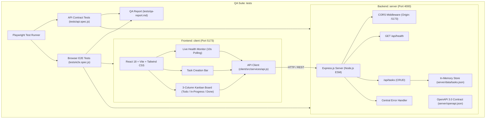

# Project Specification: TaskPulse Kanban & System Health

## 1. Executive Summary
**TaskPulse** is a lightweight, responsive Kanban board web application with real-time backend health monitoring. It is architected for strict modularity, clean separation of concerns, and rigorous contract-driven development across three distinct agent roles (Backend, Frontend, QA) coordinated by an Orchestrator.

---

## 2. System Architecture & Components



---

## 3. Network & Port Assignments

| Service | Environment | Port | Base URL | Protocol |
| :--- | :--- | :--- | :--- | :--- |
| **Backend API** | Node.js / Express | `4000` | `http://localhost:4000/api` | HTTP/REST |
| **Frontend UI** | Vite / React Dev | `5173` | `http://localhost:5173` | HTTP |
| **Health Monitor** | Polling Endpoint | `4000` | `http://localhost:4000/api/health` | HTTP GET (10s interval) |

---

## 4. API Contract & Data Models

### 4.1 Data Models

#### Task Object
```json
{
  "id": "uuid-or-string",
  "title": "string (non-empty)",
  "priority": "low" | "medium" | "high",
  "status": "todo" | "in-progress" | "done",
  "createdAt": "2026-10-22T08:30:00.000Z"
}
```

#### Health Status Object
```json
{
  "status": "healthy",
  "uptime": 124.5,
  "timestamp": "2026-10-22T08:30:00.000Z"
}
```

#### Standard Error Response
```json
{
  "error": "Error message describing the failure",
  "statusCode": 400
}
```

### 4.2 Endpoint Specifications

| Method | Endpoint | Description | Request Body | Success Response | Status Codes |
| :--- | :--- | :--- | :--- | :--- | :--- |
| `GET` | `/api/health` | Live service health check | None | Health Status Object | `200` |
| `GET` | `/api/tasks` | Retrieve all tasks | None | `Array<Task>` | `200` |
| `POST` | `/api/tasks` | Create a new task | `{ "title": string, "priority": "low"|"medium"|"high" }` | Created `Task` (default status `"todo"`) | `201`, `400` |
| `PATCH` | `/api/tasks/:id` | Update task status or priority | `{ "status"?: string, "priority"?: string }` | Updated `Task` | `200`, `400`, `404` |
| `DELETE` | `/api/tasks/:id` | Remove a task | None | Empty / None | `204`, `404` |

---

## 5. Execution Phases & Persona Governance

### Phase 1: API Contract & Backend Implementation
- **Assigned Persona:** `Backend Developer Agent` (`.agents/personas/backend-agent.md`)
- **Bound Skills:** `.agents/skills/nodejs-backend-patterns/SKILL.md`
- **Scope:** Directory `/server/**`
- **Key Deliverables:**
  1. `server/openapi.json` generated and validated.
  2. Express server with ESM, CORS configured for `http://localhost:5173`.
  3. In-memory storage with persistence fallback to `server/data/tasks.json`.
  4. Endpoints implemented: `/api/health`, `/api/tasks` (CRUD).
  5. Centralized error handling and payload validation middleware.
- **Gate 1 Handoff Criteria:**
  - `server/openapi.json` exists and is syntactically valid.
  - `GET http://localhost:4000/api/health` returns `200 OK` with `{ "status": "healthy", ... }`.

### Phase 2: Frontend UI & API Integration
- **Assigned Persona:** `Frontend Developer Agent` (`.agents/personas/frotnend-agent.md`)
- **Bound Skills:** `.agents/skills/vercel-react-best-practices/SKILL.md`, `.agents/skills/tailwind-design-system/SKILL.md`
- **Scope:** Directory `/client/**` (Allowed to read `server/openapi.json`, `PROJECT_SPEC.md`)
- **Key Deliverables:**
  1. React 18+ app with Vite and Tailwind CSS.
  2. `client/src/services/api.js` consuming backend endpoints per `server/openapi.json`.
  3. Header Bar with live Health Badge (polls `/api/health` every 10s, pulse animation).
  4. Task Creation Bar with inputs for `title`, `priority`, and submit button (`data-testid="add-task-btn"`).
  5. 3-Column Kanban Board (`todo`, `in-progress`, `done`) with card actions (`data-testid="move-task-<id>"`, `data-testid="delete-task-<id>"`).
- **Gate 2 Handoff Criteria:**
  - `/client` builds cleanly with zero errors (`npm run build`).
  - Kanban board UI connects to `http://localhost:4000/api` and handles real tasks.

### Phase 3: End-to-End & API Contract Verification
- **Assigned Persona:** `QA Automation Agent` (`.agents/personas/qa-agent.md`)
- **Bound Skills:** `.agents/skills/playwright-best-practices/SKILL.md`
- **Scope:** Directory `/tests/**` (Read-only on `/server/**`, `/client/**`)
- **Key Deliverables:**
  1. Playwright test configuration for API and E2E suites.
  2. `tests/api.spec.js`: Contract tests for `/api/health` and `/api/tasks`.
  3. `tests/e2e.spec.js`: User flows (board rendering, health badge, create task, move columns, delete).
  4. `tests/qa-report.md`: Detailed audit table with pass/fail status and latency metrics.
- **Gate 3 Release Criteria:**
  - All automated tests in `/tests` pass with zero errors.
  - Comprehensive `tests/qa-report.md` finalized.
